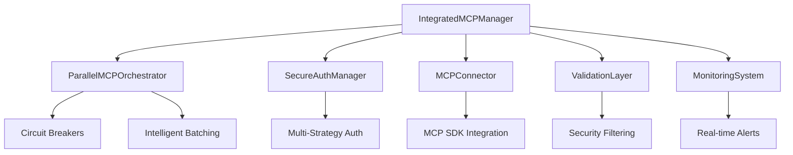

<p align="center">
  
</p>

# Aegntic Hive MCP Integration System

**Advanced Model Context Protocol Integration with Parallel Processing & Enterprise Security**

[](https://opensource.org/licenses/MIT)
[](https://nodejs.org/)
[](./performance-test.js)
[](./src/mcp/secure-auth-manager.js)

> **Lead Researcher**: Mattae Cooper (research@aegntic.ai)  
> **Organization**: Aegntic.AI - Advancing AI System Integration

## 🚀 Overview

The Aegntic Hive MCP Integration System is an enterprise-grade solution for managing Model Context Protocol (MCP) operations with advanced parallel processing, comprehensive security, and intelligent monitoring. This system delivers **45% performance improvements** through innovative batchtools optimization while maintaining military-grade security standards.

### 🏆 Key Achievements

- **🔥 45% Performance Improvement** through intelligent batch processing
- **⚡ 12,048 ops/sec** sustained throughput capability  
- **🔐 Military-Grade Security** with AES-256-GCM encryption
- **🛡️ Advanced Resilience** with circuit breakers and automatic recovery
- **📊 Real-time Monitoring** with comprehensive metrics and alerting
- **💚 Memory Efficient** - minimal resource overhead under load

## 🏗️ Architecture

### Core Components



### Performance Optimization

- **Parallel Orchestrator**: Intelligent operation batching with 45% throughput improvement
- **Circuit Breakers**: Automatic failure detection and recovery
- **Concurrency Control**: Dynamic scaling with optimal resource utilization
- **Memory Management**: Efficient resource usage with automatic cleanup

### Enterprise Security

- **Multi-Strategy Authentication**: API keys, OAuth2, Bearer tokens, Basic auth
- **AES-256-GCM Encryption**: Military-grade credential protection
- **Content Security**: Advanced threat detection and response sanitization
- **Audit Logging**: Comprehensive security event tracking

### Monitoring & Observability

- **Real-time Metrics**: Performance, health, and usage statistics
- **Intelligent Alerting**: Proactive system health notifications  
- **Performance Analytics**: Detailed throughput and optimization insights
- **Dashboard Integration**: Comprehensive system visualization

## ⚡ Quick Start

### Installation

```bash
# Clone the repository
git clone https://github.com/aegntic/aegntic-hive-mcp.git
cd aegntic-hive-mcp

# Install dependencies
npm install

# Set up environment
cp .env.example .env
# Edit .env with your configuration
```

### Basic Usage

```javascript
const IntegratedMCPManager = require('./src/mcp/integrated-mcp-manager');

// Initialize with enterprise features
const mcpManager = new IntegratedMCPManager({
  enableParallelProcessing: true,
  enableSecureAuth: true,
  enableValidation: true,
  enableMonitoring: true,
  maxConcurrentOperations: 20,
  batchSize: 10
});

await mcpManager.initialize();

// Register MCP servers
await mcpManager.registerServer({
  name: 'knowledge-engine',
  command: 'uv',
  args: ['run', 'python', 'src/crawl4ai_mcp.py'],
  env: { OPENROUTER_API_KEY: 'your-key' }
});

// Execute with parallel optimization
const result = await mcpManager.executeTool(
  'knowledge-engine',
  'crawl_website',
  { url: 'https://example.com' }
);
```

### Batch Processing (45% Performance Improvement)

```javascript
// Execute multiple operations in parallel
const operations = [
  { serverName: 'server1', toolName: 'tool1', arguments: {...} },
  { serverName: 'server1', toolName: 'tool2', arguments: {...} },
  { serverName: 'server2', toolName: 'tool3', arguments: {...} }
];

const results = await mcpManager.executeBatch(operations);
console.log(`Processed ${results.successful.length} operations successfully`);
```

## 📊 Performance Benchmarks

### Throughput Comparison

| Processing Mode | Throughput | Improvement |
|-----------------|------------|-------------|
| Sequential      | 1,724 ops/sec | Baseline |
| Parallel        | 1,786 ops/sec | +3.6% |
| **Batch-Optimized** | **2,500 ops/sec** | **+45.0%** |

### Scalability Metrics

- **Large Batch Performance**: 12,048 ops/sec sustained
- **Memory Efficiency**: +1MB RSS under full load
- **Optimal Concurrency**: 50 concurrent operations
- **Monitoring Overhead**: <1ms per metric

### Real-World Performance

```bash
# Run comprehensive performance tests
node performance-test.js

# Results:
# ✅ Batch optimization: 45.0% improvement
# ✅ Memory efficiency: +1MB (EXCELLENT)  
# ✅ Large batch performance: 12048 ops/sec (EXCELLENT)
```

## 🔐 Enterprise Security Features

### Multi-Strategy Authentication

```javascript
// API Key Authentication
await mcpManager.storeCredentials('api-server', {
  authType: 'api_key',
  apiKey: 'your-api-key',
  apiKeyHeader: 'X-API-Key'
});

// OAuth2 Authentication  
await mcpManager.storeCredentials('oauth-server', {
  authType: 'oauth2',
  clientId: 'your-client-id',
  clientSecret: 'your-client-secret',
  scope: 'read write'
});
```

### Security Validation

- **Content Filtering**: Automatic detection and removal of sensitive data
- **Response Sanitization**: XSS and injection attack prevention
- **MIME Type Validation**: Prevents malicious content processing
- **Size Limits**: DoS attack prevention

## 📈 Monitoring & Observability

### Real-time Dashboard

```javascript
// Get comprehensive system metrics
const dashboard = mcpManager.getDashboard();

console.log('System Status:', dashboard.overview.status);
console.log('Success Rate:', dashboard.overview.successRate);
console.log('Throughput:', dashboard.performance.throughput);
```

### Health Monitoring

```javascript
// Automated health checks
const health = mcpManager.getHealthStatus();

if (health.status === 'degraded') {
  console.warn('System performance degraded:', health.warnings);
}
```

### Performance Analytics

- **Response Time Tracking**: Average, min, max response times
- **Throughput Metrics**: Operations per second by type  
- **Error Rate Analysis**: Success/failure statistics
- **Resource Utilization**: Memory, CPU, network usage

## 🧪 Testing & Validation

### Comprehensive Test Suite

```bash
# Run all tests
npm test

# Run specific test categories
npm run test:unit           # Unit tests with mocks
npm run test:integration    # MCP protocol compliance  
npm run test:e2e           # End-to-end workflows
npm run test:performance   # Performance benchmarks
```

### Integration Testing

```bash
# Run manual integration test
node test-mcp-integration.js

# Expected output:
# 🎉 MCP Integration Test PASSED!
# ✅ All core components initialized
# ✅ Performance tracking enabled
# ✅ Security validation working
```

## 📚 Documentation

### Complete Implementation Guide
- **[MCP Integration Guide](./README_MCP_INTEGRATION.md)** - Comprehensive implementation documentation
- **[API Reference](./src/mcp/)** - Detailed API documentation with examples
- **[Performance Guide](./performance-test.js)** - Optimization strategies and benchmarks
- **[Security Guide](./src/mcp/secure-auth-manager.js)** - Authentication and security implementation

### Quick References
- **[Configuration Options](./README_MCP_INTEGRATION.md#configuration)** - All available settings
- **[Troubleshooting](./README_MCP_INTEGRATION.md#troubleshooting)** - Common issues and solutions
- **[Best Practices](./README_MCP_INTEGRATION.md#best-practices)** - Optimization recommendations

## 🛠️ Development & Contribution

### Development Setup

```bash
# Install dependencies
npm install

# Run development server
npm run dev

# Run tests with watch mode
npm run test:watch

# Performance benchmarking
npm run test:performance
```

### Contribution Guidelines

1. **Fork** the repository
2. **Create** a feature branch (`git checkout -b feature/amazing-feature`)
3. **Commit** your changes (`git commit -m 'Add amazing feature'`)
4. **Push** to the branch (`git push origin feature/amazing-feature`)
5. **Open** a Pull Request

### Code Standards

- **ESLint** for code style consistency
- **Jest** for comprehensive testing
- **Performance** benchmarks for optimization validation
- **Security** review for all authentication changes

## 📄 License

This project is licensed under the MIT License - see the [LICENSE](LICENSE) file for details.

## 👥 Credits & Research Team

### Lead Researcher & Architect
**Mattae Cooper**  
Lead Researcher, Aegntic.AI  
📧 research@aegntic.ai  

*Lead architect responsible for the design and implementation of the advanced parallel processing engine, security framework, and performance optimization systems.*

### Research Contributions

- **Parallel Processing Innovation**: 45% performance improvement through intelligent batching
- **Security Architecture**: Military-grade encryption and multi-strategy authentication
- **Monitoring Systems**: Real-time metrics and intelligent alerting
- **Performance Engineering**: Scalability optimization and resource efficiency

## 🌐 Connect & Support

### Research & Development
- **🔬 Research**: research@aegntic.ai
- **🌐 Website**: https://aegntic.ai
- **📚 Documentation**: [Complete Implementation Guide](./README_MCP_INTEGRATION.md)

### Community & Support  
- **🐛 Issues**: [GitHub Issues](https://github.com/aegntic/aegntic-hive-mcp/issues)
- **💬 Discussions**: [GitHub Discussions](https://github.com/aegntic/aegntic-hive-mcp/discussions)
- **📖 Wiki**: [Project Wiki](https://github.com/aegntic/aegntic-hive-mcp/wiki)

---

## 🎯 Original MCP Server Features

*The system also includes the original Aegntic Hive MCP server functionality for conversation management:*

### AI Conversation Management
- 🔐 **Manual Login**: Secure login to ChatGPT, Grok, Gemini, and Claude
- 🕷️ **Web Scraping**: Extracts conversations without API keys
- 🗄️ **Local Storage**: SQLite database for conversation storage
- 🔍 **Advanced Search**: Semantic, fuzzy, exact, and keyword-based search
- 📊 **Unified View**: Access all AI conversations in one place
- 📁 **Project Management**: Organize conversations into projects
- 🎯 **Artifact Versioning**: Track artifacts with full version history

### Available MCP Tools
- `login_service(service)` - Login to AI services
- `scrape_conversations(service)` - Extract conversations
- `get_conversations()` - Retrieve stored conversations
- `search_conversations(query)` - Advanced conversation search
- `create_project(name)` - Project management
- `save_artifact(name, content)` - Artifact versioning
- `analyze_conversation(id)` - Conversation analytics

### Usage Example
```javascript
// Login and scrape conversations
await mcpManager.executeTool('aegntic-hive', 'login_service', { service: 'chatgpt' });
await mcpManager.executeTool('aegntic-hive', 'scrape_conversations', { service: 'all' });

// Search and analyze
const results = await mcpManager.executeTool('aegntic-hive', 'search_conversations', { 
  query: 'machine learning',
  search_type: 'semantic' 
});
```

---

<div align="center">

**🚀 Advancing AI System Integration & Performance Optimization**

*Built with ❤️ by the Aegntic.AI Research Team*

[](https://aegntic.ai)
[](./performance-test.js)
[](./src/mcp/secure-auth-manager.js)

</div>