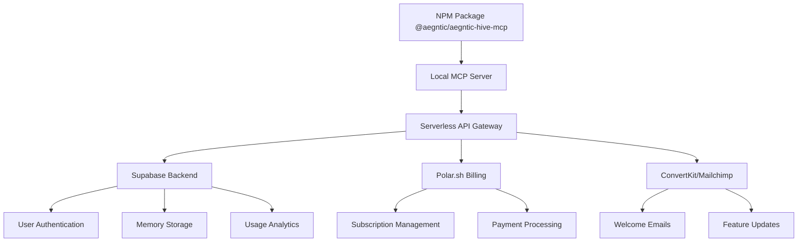
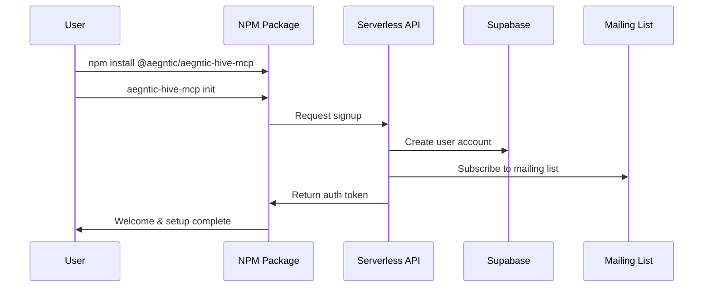

# Aegntic Hive MCP - Serverless SaaS Architecture

## 🏗️ Architecture Overview

Transform the Aegntic Hive MCP system into a serverless SaaS platform with:
- **NPM Package**: `@aegntic/aegntic-hive-mcp` for easy installation
- **Serverless Backend**: Vercel/Netlify functions for scalability
- **Supabase Integration**: Secure online memory and user management
- **Polar.sh Payments**: Subscription management and billing
- **Mailing List**: Automated user onboarding and engagement

## 🌐 System Components



### Core Architecture Principles

1. **Serverless-First**: Zero infrastructure management
2. **Global CDN**: Fast worldwide access via NPM
3. **Secure by Design**: End-to-end encryption for user data
4. **Scalable Storage**: Supabase for unlimited growth
5. **Transparent Billing**: Polar.sh for developer-friendly payments

## 📦 NPM Package Structure

```
@aegntic/aegntic-hive-mcp/
├── bin/
│   └── aegntic-hive-mcp.js        # CLI entry point
├── src/
│   ├── client/                     # MCP client implementation
│   ├── auth/                       # Authentication manager
│   ├── sync/                       # Online memory sync
│   └── api/                        # API client for serverless backend
├── config/
│   ├── default.json               # Default configuration
│   └── schemas/                   # Configuration validation
├── docs/                          # Documentation
└── examples/                      # Usage examples
```

## 🔐 Authentication Flow



## 💾 Supabase Schema Design

### Users Table
```sql
CREATE TABLE users (
    id UUID PRIMARY KEY DEFAULT gen_random_uuid(),
    email VARCHAR(255) UNIQUE NOT NULL,
    full_name VARCHAR(255),
    plan_type VARCHAR(50) DEFAULT 'free',
    created_at TIMESTAMP DEFAULT NOW(),
    last_active TIMESTAMP DEFAULT NOW(),
    usage_stats JSONB DEFAULT '{}',
    preferences JSONB DEFAULT '{}'
);
```

### Memory Storage Table
```sql
CREATE TABLE user_memories (
    id UUID PRIMARY KEY DEFAULT gen_random_uuid(),
    user_id UUID REFERENCES users(id) ON DELETE CASCADE,
    memory_type VARCHAR(50) NOT NULL,
    memory_key VARCHAR(255) NOT NULL,
    memory_data JSONB NOT NULL,
    encrypted_data TEXT,
    created_at TIMESTAMP DEFAULT NOW(),
    updated_at TIMESTAMP DEFAULT NOW(),
    UNIQUE(user_id, memory_key)
);
```

### Conversations Table
```sql
CREATE TABLE conversations (
    id UUID PRIMARY KEY DEFAULT gen_random_uuid(),
    user_id UUID REFERENCES users(id) ON DELETE CASCADE,
    service VARCHAR(50) NOT NULL,
    conversation_id VARCHAR(255) NOT NULL,
    title TEXT,
    messages JSONB DEFAULT '[]',
    metadata JSONB DEFAULT '{}',
    created_at TIMESTAMP DEFAULT NOW(),
    updated_at TIMESTAMP DEFAULT NOW()
);
```

### Projects Table
```sql
CREATE TABLE projects (
    id UUID PRIMARY KEY DEFAULT gen_random_uuid(),
    user_id UUID REFERENCES users(id) ON DELETE CASCADE,
    name VARCHAR(255) NOT NULL,
    description TEXT,
    settings JSONB DEFAULT '{}',
    created_at TIMESTAMP DEFAULT NOW(),
    updated_at TIMESTAMP DEFAULT NOW()
);
```

## 💳 Service Tiers with Polar.sh

### Free Tier
- **Price**: $0/month
- **Features**:
  - 100 AI conversations/month
  - 1GB memory storage
  - Basic search capabilities
  - Community support
- **Polar.sh Product ID**: `prod_free_tier`

### Pro Tier
- **Price**: $29/month
- **Features**:
  - Unlimited AI conversations
  - 10GB memory storage
  - Advanced analytics
  - Priority support
  - Export capabilities
- **Polar.sh Product ID**: `prod_pro_tier`

### Enterprise Tier
- **Price**: $99/month
- **Features**:
  - Everything in Pro
  - Team collaboration
  - SSO integration
  - Custom integrations
  - Dedicated support
- **Polar.sh Product ID**: `prod_enterprise_tier`

## 🚀 Serverless API Endpoints

### Authentication Endpoints
```typescript
// POST /api/auth/signup
interface SignupRequest {
  email: string;
  fullName?: string;
  agreeToTerms: boolean;
  subscribeNewsletter: boolean;
}

// POST /api/auth/signin
interface SigninRequest {
  email: string;
  token?: string; // For passwordless login
}

// GET /api/auth/me
interface UserProfile {
  id: string;
  email: string;
  fullName: string;
  planType: 'free' | 'pro' | 'enterprise';
  usageStats: UsageStats;
}
```

### Memory Sync Endpoints
```typescript
// POST /api/memory/sync
interface MemorySyncRequest {
  memories: Array<{
    key: string;
    data: any;
    type: 'conversation' | 'project' | 'artifact';
  }>;
}

// GET /api/memory/:key
interface MemoryResponse {
  key: string;
  data: any;
  updatedAt: string;
}
```

### Billing Integration
```typescript
// GET /api/billing/plans
interface BillingPlan {
  id: string;
  name: string;
  price: number;
  features: string[];
  polarProductId: string;
}

// POST /api/billing/subscribe
interface SubscriptionRequest {
  planId: string;
  polarCheckoutUrl: string;
}
```

## 🛠️ Implementation Strategy

### Phase 1: NPM Package Foundation
1. **Package Setup**: Create `@aegntic/aegntic-hive-mcp` structure
2. **CLI Interface**: Implement user-friendly command line interface
3. **Local MCP Server**: Maintain existing functionality offline-first
4. **Configuration Management**: Flexible config with environment detection

### Phase 2: Serverless Backend
1. **Vercel Functions**: Deploy scalable API endpoints
2. **Supabase Integration**: Database setup and connection
3. **Authentication System**: JWT-based auth with refresh tokens
4. **Memory Sync**: Bi-directional synchronization

### Phase 3: Payment Integration
1. **Polar.sh Setup**: Configure products and webhooks
2. **Subscription Logic**: Plan limits and feature gating
3. **Usage Tracking**: Monitor API calls and storage
4. **Billing Dashboard**: User-friendly subscription management

### Phase 4: Enhanced Features
1. **Team Collaboration**: Shared projects and conversations
2. **Advanced Analytics**: Usage insights and trends
3. **Export Functions**: Multiple format support
4. **Integration APIs**: Third-party service connections

## 🔒 Security Considerations

### Data Protection
- **End-to-End Encryption**: All sensitive data encrypted client-side
- **Zero-Knowledge Architecture**: Server cannot decrypt user data
- **GDPR Compliance**: Data portability and deletion rights
- **SOC 2 Compliance**: Enterprise security standards

### Authentication Security
- **JWT Tokens**: Short-lived access tokens with refresh mechanism
- **Rate Limiting**: Protect against abuse and DDoS
- **IP Whitelisting**: Enterprise security features
- **Audit Logging**: Complete security event tracking

## 📊 Monitoring & Analytics

### User Analytics
```typescript
interface UsageStats {
  conversationsThisMonth: number;
  storageUsedMB: number;
  lastActiveDate: string;
  featureUsage: {
    search: number;
    export: number;
    projects: number;
  };
}
```

### System Health Monitoring
- **API Response Times**: Track endpoint performance
- **Error Rates**: Monitor and alert on failures
- **Database Performance**: Query optimization
- **User Satisfaction**: NPS surveys and feedback

## 🚀 Deployment Strategy

### Infrastructure
- **Frontend**: Vercel for serverless functions
- **Database**: Supabase for PostgreSQL + Auth
- **CDN**: NPM registry for global package distribution
- **Monitoring**: Vercel Analytics + Supabase Dashboard
- **Email**: ConvertKit for transactional and marketing emails

### CI/CD Pipeline
1. **GitHub Actions**: Automated testing and deployment
2. **Semantic Versioning**: Automated NPM releases
3. **Environment Management**: Dev/Staging/Production
4. **Database Migrations**: Automated schema updates

## 💰 Business Model

### Revenue Streams
1. **Subscription Revenue**: Monthly/annual plans
2. **Usage-Based Pricing**: Enterprise overages
3. **Premium Features**: Advanced analytics and integrations
4. **Enterprise Licenses**: Custom deployments

### Cost Structure
- **Supabase**: ~$25/month for moderate usage
- **Vercel**: ~$20/month for serverless functions  
- **ConvertKit**: ~$29/month for email marketing
- **Polar.sh**: 5% + $0.30 per transaction
- **Support**: Scale with customer success team

### Projected Economics (Monthly)
- **100 Free Users**: $0 revenue, ~$50 costs
- **50 Pro Users**: $1,450 revenue, ~$100 costs  
- **10 Enterprise Users**: $990 revenue, ~$50 costs
- **Net Profit**: ~$2,290/month at scale

## 🎯 Go-to-Market Strategy

### Launch Sequence
1. **Beta Release**: Invite existing GitHub community
2. **Product Hunt**: Official product launch
3. **Developer Communities**: Share in AI/MCP forums
4. **Content Marketing**: Technical blog posts and tutorials
5. **Partnership Program**: Integrate with other MCP servers

### Marketing Channels
- **Technical Content**: Blog posts, case studies, tutorials
- **Community Engagement**: Discord, Reddit, Twitter
- **Developer Relations**: Conference talks, workshops
- **Email Marketing**: Newsletter with AI/productivity content
- **SEO Optimization**: Target "MCP server", "AI productivity" keywords

This serverless architecture transforms the Aegntic Hive MCP system into a scalable SaaS platform while maintaining the high performance and security standards established in the original implementation.